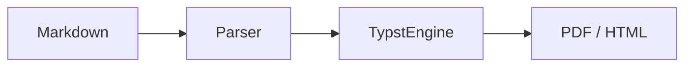

# Botox: Publication-Grade Typesetting & Presentations

Botox is a high-performance, single native binary document compiler written in pure Rust. It transforms standard Markdown into LaTeX-quality PDF documents or interactive HTML slide decks using an in-process Typst typesetting engine—without requiring Pandoc, TeX Live, or Node.js.

---

## 1. Core Principles & Workflow Selection

Botox operates in two primary modes determined automatically from Markdown frontmatter or CLI flags:

### A. Document Mode (Default)
- **Primary Target**: Paginated PDF documents (`.pdf`), with optional HTML (`.html`) or JSON vector pages (`.json`).
- **Use Cases**: Academic papers, technical specifications, books, RFCs, essays, reports, and cheat sheets.
- **Trigger**: Standard Markdown without `marp: true` or `presentation: true`, or when `--pdf` is passed explicitly.

### B. Presentation Slide Deck Mode
- **Primary Target**: Interactive HTML slide decks (`.html`), with optional PDF export (`-o deck.pdf`).
- **Use Cases**: Conference talks, lecture slides, pitch decks, and technical presentations.
- **Trigger**: Markdown containing `marp: true`, `slides: true`, or `presentation: true` in YAML frontmatter, or when `--slides` is passed explicitly.
- **Slide Delimiters**: Slides are separated by horizontal rules (`---`, `===`, or `\newpage`).
- **Stepwise Reveals**: Supports incremental pause points via `<!-- pause -->` or `\pause`.

---

## 2. Command Line Interface (CLI) Reference

### Common Invocation Patterns
```bash
# 1. Initialize new templates
botox init document.md               # Scaffold an academic PDF document template
botox init slides.md                 # Scaffold an interactive presentation slide deck

# 2. Compile documents (defaults to .pdf output)
botox document.md                    # Compiles to document.pdf
botox document.md -o custom.pdf      # Explicit PDF destination
botox document.md -o document.html   # Export document to HTML reader
botox document.md -o pages.json      # Export vector SVG pages JSON for webviews

# 3. Compile presentations (defaults to .html output)
botox slides.md                      # Compiles to interactive slides.html
botox slides.md -o deck.pdf          # Export presentation slides to PDF

# 4. Live watch mode (recompiles automatically on change)
botox -w document.md
botox --watch slides.md

# 5. Unix standard I/O streaming (stream PDF directly to stdout)
cat document.md | botox - -o - > output.pdf

# 6. Configuration inspection & Agent Skills
botox config                         # Display active configuration cascade
botox setup                          # Interactive configuration wizard
botox setup --global --author "Name" # Non-interactive config setup
botox skills                         # Generate .agents/skills/botox/SKILL.md in project
botox skills --global                # Install to ~/.agents/skills/botox/SKILL.md
botox skills -o -                    # Print skill definition directly to stdout
```

### Complete CLI Flag Table
| Flag / Option | Argument | Description | Default |
| :--- | :--- | :--- | :--- |
| `-o, --output` | `<path>` | Output destination (`.pdf`, `.html`, `.svg`, `.json`, or `-` for stdout) | `.pdf` (doc), `.html` (slides) |
| `-w, --watch` | None | Continuously watch input file & directory for changes and recompile | Disabled |
| `--pdf` | None | Force PDF compilation mode regardless of frontmatter | Auto-detected |
| `--slides` | None | Force presentation slide deck mode | Auto-detected |
| `--theme` | `<theme>` | Document theme (`academic`, `modern`, `elegant`, `technical`, `compact`, `minimal`) or Slide theme (`default`, `academic`, `gaia`, `uncover`, `nord`, `dark`) | `academic` / `default` |
| `--toc` | None | Enable automatic Table of Contents | Config/Frontmatter |
| `--no-toc` | None | Explicitly disable Table of Contents | Disabled |
| `--author` | `<name>` | Override primary author name | Config/Frontmatter |
| `--font` | `<name>` | Primary typeface family | `New Computer Modern` |
| `-N, --number-sections`| None | Number headings automatically (1, 1.1, 1.1.1) | Disabled |
| `-b, --bibliography` | None | Transform hyperlinks into IEEE numbered citations `[1]` with an end bibliography | Disabled |
| `--no-bibliography` | None | Disable link-to-citation bibliography transformation | Enabled |
| `--exclude-ref` | `<csv>` | Comma-separated domains/patterns to exclude from bibliography (e.g. `github.com,x.com`) | None |
| `--include-ref` | `<csv>` | Comma-separated domains/patterns to restrict bibliography citations to | None |
| `--config` | `<path>` | Path to custom `botox.yaml` configuration file | Auto-discovered |

---

## 3. Document Frontmatter & Metadata Reference

Documents declare configuration in YAML frontmatter enclosed by `---`:

```yaml
---
title: "Autonomous Agentic Workflows in Distributed Systems"
subtitle: "An Architectural Analysis and Implementation Survey"
author:
  - name: "Dr. Jane Doe"
    affiliation: "Department of Computer Science, MIT"
    email: "jdoe@mit.edu"
  - name: "John Smith"
    affiliation: "AI Systems Laboratory"
date: \today                         # Or "2026-10-13", or "October 2026"
abstract: >
  This paper explores modern autonomous agent architectures, evaluating memory
  retrieval latency, multi-pass tool invocation, and formal layout engines.
keywords: "distributed systems, agentic coding, typst, rust"
lang: en
papersize: a4                        # a4, us-letter, a5
fontsize: 11pt                       # 9pt, 10pt, 11pt, 12pt
mainfont: "New Computer Modern"      # Any system font or embedded font
mathfont: "New Computer Modern Math"
monofont: "DejaVu Sans Mono"
columns: 1                           # 1 (single column) or 2 (two-column layout)
column-gutter: 18pt                  # Gutter between columns in two-column mode
linestretch: 1.15                    # Line spacing multiplier
geometry: "margin=2.5cm"             # Or margin: "1in", or margin: { x: "2cm", y: "2.5cm" }
number-sections: true                # Automatically number section headings
table-of-contents: true              # Generate Table of Contents
toc-depth: 3                         # 1 (H1), 2 (H1-H2), 3 (H1-H3)
toc-title: "Table of Contents"       # Custom outline header
linkcolor: "#2563eb"                 # Hex color or named color (blue, red, teal, etc.)
bibliography: true                   # Transform web links into an IEEE bibliography
exclude-references:
  - "github.com"
  - "x.com"
theme: academic                      # academic, modern, elegant, technical, compact, minimal
---
```

### Supported Author Formats
1. **Single String**: `author: "Jane Doe"`
2. **List of Strings**: `author: ["Jane Doe", "John Smith"]`
3. **List of Structured Maps**:
   ```yaml
   author:
     - name: "Jane Doe"
       affiliation: "MIT CSAIL"
     - name: "John Smith"
       affiliation: "Stanford University"
   ```

### Document Themes Detailed
* **`academic`** (Default):
  - Typeset in New Computer Modern with classical serif proportions.
  - Centered title, bold section headers, indented paragraphs, clean horizontal rules.
  - Standard IEEE / ACM / arXiv style.
* **`modern`**:
  - Contemporary sans-serif styling with prominent colored accent bars.
  - Blue accent highlights (`#2563eb`), card-style abstract containers, and crisp headings.
  - Excellent for whitepapers, product briefs, and executive summaries.
* **`elegant`**:
  - Warm editorial aesthetic with warm amber and deep slate accents.
  - Centered titles, generous leading, classical Roman numerals, and subtle borders.
  - Ideal for long-form essays, books, and thought leadership pieces.
* **`technical`**:
  - Engineering specification format with monospace metadata headers.
  - Teal borders (`#0d9488`), grid-aligned author/date blocks, and structured code blocks.
  - Tailored for RFCs, API designs, and systems documentation.
* **`compact`**:
  - Space-optimized multi-column layout with slim margins and dense line spacing.
  - Ideal for two-column conference papers, cheat sheets, and technical summaries.
* **`minimal`**:
  - Distraction-free pure typography with zero decorative rules or background tinting.
  - Maximum typographic focus on content.

---

## 4. Presentation Slide Decks (Marp Compatibility)

To author presentation slides, include `marp: true` or `slides: true` in frontmatter:

```yaml
---
marp: true
theme: default                       # default, academic, gaia, uncover, nord, dark
paginate: true                       # Show slide numbers (e.g. 1 / 15)
header: "Engineering Review Q4"      # Persistent slide header
footer: "Confidential"               # Persistent slide footer
size: 16:9                           # 16:9 (default) or 4:3
color: "#f8fafc"                     # Optional global text color
backgroundColor: "#0f172a"          # Optional global slide background color
---

# Scalable Agent Architecture
### Distributed Systems Group

---

# Architecture Overview

- **Core Compiler**: Pure Rust single native binary
- **Layout Engine**: In-process Typst vector pipeline
- **Latency**: Sub-10ms incremental recompiles

---

# Data Pipeline



<!-- pause -->

> [!NOTE]
> All diagram compilation is cached locally using content SHA256 hashes.
```

### Slide Mechanics & Controls
* **Slide Dividers**: Use `---`, `===`, or `\newpage` on an isolated line to begin a new slide.
* **Incremental Steps (`\pause` or `<!-- pause -->`)**:
  - Inserts a stepwise reveal point. In the interactive HTML viewer, items after the pause are revealed on the next slide transition or arrow key press.
* **Interactive HTML Presentation Controls**:
  - `Right Arrow` / `Down Arrow` / `Space` / `Enter` / `N`: Next slide or next pause step.
  - `Left Arrow` / `Up Arrow` / `Page Up` / `P`: Previous slide.
  - `Home` / `End`: First / last slide.
  - `F`: Toggle full-screen presentation mode.
  - `O`: Toggle interactive thumbnail overview grid.
  - `Esc`: Close thumbnail overview or exit fullscreen.
  - Touch: Horizontal swipe gestures on mobile and tablets.
* **Slide Themes**:
  - `default`: Clean, bright presentation theme with crisp typography.
  - `academic`: Beamer-inspired presentation theme for academic conferences.
  - `gaia`: Warm terracotta and earth tones (compatible with Marp Gaia).
  - `uncover`: High-contrast minimalist theme with centered slide elements.
  - `nord`: Cool Arctic Frost palette with slate-blue background.
  - `dark`: Sleek charcoal dark mode.

---

## 5. Diagrams & Visualizations (Kroki & Mermaid)

Botox natively converts diagram code fences into sharp, scalable vector graphics. Diagrams are rendered, cached locally by content SHA256, and embedded as native vector assets.

### Supported Diagram Engines
| Fence Identifier | Engine | Description |
| :--- | :--- | :--- |
| `mermaid` | Mermaid.js | Flowcharts, sequence diagrams, class, state, gitGraph, erDiagram, gantt |
| `umlet`, `uxf` | UMLet | Fast UML class, sequence, activity, and deployment diagrams |
| `plantuml`, `puml` | PlantUML | Component, sequence, state, class, and deployment diagrams |
| `c4plantuml` | C4-PlantUML | C4 software architecture diagrams |
| `graphviz`, `dot` | Graphviz | Directed graphs, network topologies, finite state machines |
| `d2` | D2 Lang | Declarative modern diagrams with auto-layout |
| `bytefield` | Bytefield | Binary protocol packet structures and memory layouts |
| `ditaa` | Ditaa | ASCII art converted to diagrams |
| `wavedrom` | WaveDrom | Digital timing waveforms |
| `bpmn` | BPMN | Business Process Model and Notation |
| `erd` | ERD | Entity-Relationship Diagrams |
| `nomnoml` | Nomnoml | UML diagrams using simple syntax |
| `svgbob` | Svgbob | ASCII art diagrams to clean SVG |

### Diagram Code Fence Attributes
Pass attributes inside `{...}` on the fence header:
````markdown
```{mermaid, caption="Microservices Event Mesh", id="fig:event-mesh", width="85%"}
sequenceDiagram
    autonumber
    Client->>API Gateway: POST /orders
    API Gateway->>EventBus: OrderCreated
    EventBus->>PaymentService: Process Payment
    PaymentService-->>EventBus: PaymentCompleted
    EventBus->>InventoryService: Reserve Stock
```

As illustrated in @fig:event-mesh, orders are processed asynchronously.
````

### External Diagram & Code File Referencing
Include external files directly to prevent code duplication:
````markdown
<!-- 1. Diagram file referencing in code fence -->
```{mermaid file="architecture.mmd", caption="System Topology", id="fig:topo"}
```

<!-- 2. UMLet file referencing -->
```{umlet file="models/classes.uxf", caption="Domain Model", id="fig:domain"}
```

<!-- 3. Image syntax for diagram files -->
{#fig:network width=90%}

<!-- 4. Source code file embedding -->
```rust file="src/main.rs"
```
````

---

## 6. Mathematics & Equations

Botox supports both LaTeX mathematical macros and native Typst math syntax with LaTeX-quality typography:

### Syntax Rules
* **Inline Math**: Wrap in single dollar signs: `$f(x) = \alpha x + \beta$`
* **Display Math**: Wrap in double dollar signs:
  ```latex
  $$\int_{-\infty}^{+\infty} e^{-x^2} \, dx = \sqrt{\pi}$$
  ```
* **Equation Numbering & Cross-References**:
  ```latex
  $$\mathcal{L}(\theta) = \mathbb{E}_{x \sim p}[ \log p_\theta(x) ]$$ {#eq:loss}

  Minimizing the objective function defined in @eq:loss yields optimal parameters.
  ```

### Critical Syntax Difference: Multi-letter Variables
> [!IMPORTANT]
> In Typst math, juxtaposed characters represent multi-letter variable names rather than implicit multiplication.
> - **Incorrect**: `$E = mc^2$` (Error: unknown variable `mc`)
> - **Correct**: `$E = m c^2$` (Variable `m` multiplied by `c`)

### Supported LaTeX Mathematical Macros
* **Fractions & Roots**: `\frac{a}{b}`, `\sqrt{x}`, `\sqrt[n]{x}`
* **Calculus & Operators**: `\sum_{i=1}^n`, `\prod_{i=1}^n`, `\int_a^b`, `\oint`, `\partial`, `\nabla`, `\lim_{x \to 0}`
* **Accents & Vectors**: `\vec{v}`, `\mathbf{x}`, `\hat{y}`, `\bar{z}`, `\tilde{a}`, `\dot{x}`, `\ddot{x}`
* **Greek Alphabet**: `\alpha`, `\beta`, `\gamma`, `\delta`, `\epsilon`, `\theta`, `\lambda`, `\mu`, `\pi`, `\sigma`, `\tau`, `\phi`, `\omega`, `\Delta`, `\Gamma`, `\Theta`, `\Lambda`, `\Sigma`, `\Phi`, `\Omega`
* **Relations & Logic**: `\leq`, `\geq`, `\neq`, `\approx`, `\equiv`, `\sim`, `\forall`, `\exists`, `\in`, `\notin`, `\subset`, `\cup`, `\cap`
* **Arrows**: `\to`, `\rightarrow`, `\leftarrow`, `\Rightarrow`, `\iff`, `\mapsto`
* **Matrices**:
  ```latex
  $$\begin{bmatrix} a & b \\ c & d \end{bmatrix} \quad \begin{pmatrix} 1 & 0 \\ 0 & 1 \end{pmatrix}$$
  ```

---

## 7. Advisory Callout Blocks

Botox renders distinct, styled callout advisory boxes:

### GitHub-Style Callouts
```markdown
> [!NOTE]
> Informational context or background notes.

> [!TIP]
> Actionable recommendations for performance or best practices.

> [!IMPORTANT]
> Essential prerequisites or crucial steps.

> [!WARNING]
> Warnings regarding breaking changes or potential issues.

> [!CAUTION]
> High-risk alerts regarding security or data destruction.
```

### Custom Titles on Callouts
```markdown
> [!TIP] Optimizing Query Latency
> Adding an index on `(tenant_id, created_at)` reduces index scans by 90%.
```

### Pandoc-Style Divs
```markdown
::: note
**Pandoc Callout**: Seamlessly supported with clean theme styling.
:::

::: warning
**Caution**: Changes take effect immediately upon deployment.
:::
```

---

## 8. Tables, Cross-References & Formatting Extensions

### Pipe Tables with Captions
```markdown
| Method | Complexity | Memory | Throughput |
| :--- | :---: | :---: | ---: |
| Linear Scan | $O(N)$ | $O(1)$ | 12 MB/s |
| B-Tree Index | $O(\log N)$ | $O(N)$ | 480 MB/s |
| Hash Index | $O(1)$ | $O(N)$ | 1,250 MB/s |
Table: Performance Comparison of Index Structures {#tbl:perf}

See the comparative results in @tbl:perf.
```

### Section Headings & Numbering
* **Custom Section IDs**: `# Background & Prior Work {#sec:background}`
* **Unnumbered Headings**: `# Preface {-}` or `# Preface {.unnumbered}`
* **Referencing Sections**: `As discussed in @sec:background...`

### Page Breaks
Force page breaks in documents using any of the following:
* `\newpage`
* `\pagebreak`
* `<div style="page-break-after: always"></div>`

### Footnotes
```markdown
Modern systems employ content-addressable storage[^cas] for deduplication.

[^cas]: Content-addressable storage computes a cryptographic hash of content to use as its key.
```

---

## 9. Bibliographies & Citations

Botox provides automatic web link transformation into IEEE citation indices:

### Automatic Web Link Citations
Set `bibliography: true` in frontmatter or pass `-b` via CLI:
```markdown
The [Rust programming language](https://rust-lang.org) guarantees memory safety, while [Typst](https://typst.app) provides ultra-fast typesetting.
```
* **Output in Text**: "The Rust programming language [1] guarantees memory safety, while Typst [2] provides ultra-fast typesetting."
* **Generated End Section**:
  ```
  References
  [1] "Rust programming language", https://rust-lang.org
  [2] "Typst", https://typst.app
  ```

### Explicit References Heading
Place references anywhere in your document using `\ref`:
```markdown
\ref Selected Bibliography and Sources
```

### Filtering Citation Domains
Exclude non-academic links or include only specific domains in `botox.yaml` or frontmatter:
```yaml
exclude-references:
  - "github.com"
  - "twitter.com"
  - "x.com"
```

---

## 10. Configuration Cascade (`botox.yaml`)

Botox loads configuration hierarchically:
1. **Command Line Flags** (highest precedence)
2. **Document YAML Frontmatter**
3. **Project Local Config**: `./botox.yaml` or `./.botox.yaml`
4. **Parent Directory Configs** (walks up directory tree)
5. **Global User Config**: `~/.config/botox/config.yaml`
6. **Internal System Defaults** (lowest precedence)

### Sample `botox.yaml`
```yaml
document:
  theme: academic
  papersize: a4
  fontsize: 11pt
  mainfont: "New Computer Modern"
  section_numbering: true
  toc: false
  bibliography: true
  exclude_references:
    - "github.com"
    - "x.com"

slides:
  theme: default
  paginate: true
  font: "New Computer Modern"
```

---

## 11. Troubleshooting & Diagnostics

Botox emits structured, source-mapped error messages pointing directly to your Markdown file:

* **`[LaTeX Error]`**: Syntax error in mathematical formulas.
  - *Fix*: Check for multi-letter variables without spaces (`$m c$` instead of `$mc$`), unmatched brackets `\left( ... \right)`, or misspelled macros.
* **`[Resource Error]`**: Missing local asset, diagram, or include file.
  - *Fix*: Verify relative path to image, `.uxf`, or `.mmd` file relative to the document directory.
* **`[Typst Error]`**: Layout or typesetting constraint error.
  - *Fix*: Inspect the exact line and snippet indicated in the diagnostic.
