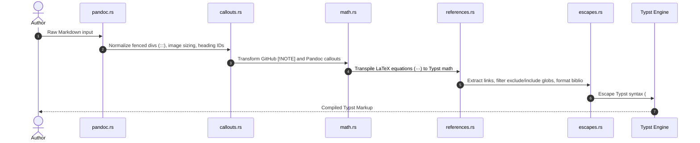
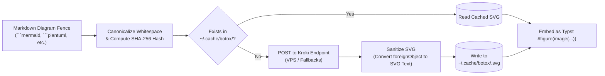

# Botox System Architecture Documentation

This document provides a comprehensive technical breakdown of the architecture, subsystems, and execution pipelines of **Botox** (the pure-Rust publishing engine) and **Botox-VSC-Ext** (its companion VS Code extension).

---

## 1. High-Level Architecture Overview

Botox replaces legacy LaTeX/Pandoc/Node toolchains by embedding an in-process Typst compilation engine (`typst-as-lib`) directly inside a single native binary, complemented by an SVG vector preview bridge for VS Code.

```mermaid
flowchart TD
    subgraph VSCodeExt["VS Code Extension (botox-vsc-ext)"]
        Editor["Markdown Editor / Buffer"]
        ExtEvents["Keystroke Debouncer (120ms)"]
        CompilerTS["src/compiler.ts\n(resolveBotoxBinary)"]
        PreviewTS["src/preview.ts\n(Webview Host Panel)"]
        WebviewDOM["Live Preview Webview\n(CSP Gated, SVG Vector Renderer, Follow-Cursor)"]

        Editor -->|On Edit / Save| ExtEvents
        ExtEvents -->|Triggers Preview| CompilerTS
        CompilerTS -->|Spawns CLI with temp JSON path| CLIProcess
        CompilerTS -->|Parses JSON Pages Output| PreviewTS
        PreviewTS -->|PostMessage SVG Pages & Headings| WebviewDOM
    end

    subgraph CLIProcess["Botox CLI Engine (Rust)"]
        MainEntry["src/main.rs\n(CLI Args & Config Resolution)"]
        ConfigLayer["src/config/\n(botox.yaml Cascading Merge)"]

        subgraph MarkdownPipeline["Markdown Preprocessing & Transpilation (src/markdown/)"]
            PandocMod["pandoc.rs\n- Fenced Divs (:::) \n- Attributes (#id, width)\n- Cross-refs (@fig-, @tbl-)"]
            CalloutMod["callouts.rs\n- GitHub [!NOTE]\n- Pandoc Callouts"]
            MathMod["math.rs\n- LaTeX to Typst Math\n- In-place Token Boundary Checks\n- Matrix & Accent Conversion"]
            EscapeMod["escapes.rs\n- Typst Syntax Escaping\n- Sub/Super/Strike Brackets"]
            RefMod["references.rs\n- URL Glob Filtering\n- Auto-Bibliography [1..N]"]
            TableMod["tables.rs\n- Captions & Cross-ref Labels"]
        end

        subgraph DiagramPipeline["Diagram Engine (src/diagrams/)"]
            HashCache["cache.rs\n- Canonicalize Code\n- SHA-256 Hash Lookup"]
            DiskCache[("Cache Dir (~/.cache/botox)\n<hash>.svg")]
            KrokiNet["kroki.rs\n- VPS Endpoint\n- kroki.io Fallback\n- mermaid.ink Fallback"]
            Sanitizer["cache.rs\n- ForeignObject to SVG Text/Tspan"]
        end

        subgraph TypstWrapper["Document / Slide Assembly"]
            DocWrap["src/document/\n- Theme Cascades\n- Page Geometry, Margins\n- Preambles & Typography"]
            SlideWrap["src/slides/\n- 16:9 / 4:3 Slides\n- Incremental Pauses (#botox_pause)"]
        end

        subgraph TypstCore["In-Process Typst Engine (src/compiler.rs)"]
            FontCache["OnceLock<fontdb::Database>\n(Embedded + Cached System Fonts)"]
            TypstLib["typst-as-lib Engine\n(PagedDocument AST Compilation)"]
            ErrorMapper["format_compilation_error\n(Typst to Markdown Source Mapping)"]
        end

        subgraph Outputs["Target Outputs"]
            PDFOut["PDF Document (via typst-pdf)"]
            JSONVector["JSON Vector Bundle\n- num_pages\n- pages: [SVG String]\n- headings & pause steps"]
            SlideHTML["HTML Interactive Presentation\n(Embedded Vector Slides)"]
        end

        MainEntry --> ConfigLayer
        MainEntry --> PandocMod
        PandocMod --> CalloutMod
        CalloutMod --> MathMod
        MathMod --> TableMod
        TableMod --> RefMod
        RefMod --> EscapeMod

        EscapeMod -->|Encounter Diagram Fence| HashCache
        HashCache -->|Cache Hit| DiskCache
        HashCache -->|Cache Miss| KrokiNet
        KrokiNet --> Sanitizer
        Sanitizer --> DiskCache
        DiskCache --> DocWrap

        EscapeMod -->|Document Mode| DocWrap
        EscapeMod -->|Slides Mode| SlideWrap

        DocWrap --> TypstCore
        SlideWrap --> TypstCore
        FontCache --> TypstLib
        TypstLib -->|Compilation Error| ErrorMapper
        ErrorMapper --> MainEntry

        TypstLib -->|Default Compile| PDFOut
        TypstLib -->|--json-pages / VS Code| JSONVector
        TypstLib -->|Slides Output| SlideHTML
    end
```

---

## 2. Core Subsystems

### 2.1 Configuration Hierarchy (`src/config/`)
Configuration cascades across three layers:
1. **User Global Config:** `~/.config/botox/config.yaml` (or Windows `%APPDATA%\botox\config.yaml`)
2. **Project Working Directory:** `./botox.yaml`
3. **Document Frontmatter:** YAML header block (`--- ... ---`) inside the Markdown file.

Settings like fonts, paper size, margins, themes, line spacing, and bibliography exclusion rules merge hierarchically, with the document frontmatter taking highest precedence.

---

### 2.2 Modular Markdown Pipeline (`src/markdown/`)

Instead of invoking an external Pandoc binary, Botox translates extended Markdown into Typst syntax in memory:

* **`pandoc.rs`**: Normalizes attributes like `{#fig:arch width=80% height=300pt}`, converting dimensions (`px` $\rightarrow$ `pt`, `\linewidth` $\rightarrow$ `%`), cross-references (`@fig:`, `@tbl:`, `@sec:`), and fenced divs (`::: {.warning}`).
* **`callouts.rs`**: Converts GitHub-style callouts (`> [!NOTE] Title`) and Pandoc divs into `#botox_callout("type", "title")[...]`. Safely handles empty titles.
* **`math.rs`**: Transpiles LaTeX syntax to Typst math. Operates in-place with token boundary matching and descending length sorting to prevent command collisions (e.g., `\tanh` vs `\tan`, `\leftarrow` vs `\le`).
* **`references.rs`**: Scans hyperlinks in the text, applies exclusion/inclusion patterns via wildcard glob matching, assigns sequential citation numbers `[1]`, and emits an IEEE-style reference bibliography.
* **`escapes.rs`**: Escapes raw Typst characters (`#`, `[`, `]`) while tracking bracket nesting depths for Botox-generated formatting macros (`#sub[...]`, `#super[...]`, `#strike[...]`).
* **`tables.rs`**: Extracts `Table: Caption {#tbl:id}` blocks and pairs them with markdown tables into Typst `#figure(...)` blocks.

---

### 2.3 Vector Diagram Pipeline (`src/diagrams/`)

Botox features built-in vector rendering for **Mermaid**, **PlantUML**, **UMLet**, **Graphviz**, and **D2**:

1. **Hashing & Caching:** Diagram source code is stripped of trailing spaces and invariant line endings, hashed via SHA-256, and checked against `~/.cache/botox/<hash>.svg`. Cache hits take **< 1ms**.
2. **Kroki Multi-Endpoint Fallback:** On cache misses, requests are sent to the configured Kroki service (with failover support).
3. **SVG Sanitization:** Mermaid diagrams often render text labels inside HTML `<foreignObject>` divs, which PDF layout engines cannot render. Botox converts these into standard SVG `<text>` and `<tspan>` nodes with proper coordinate transforms.

---

### 2.4 Compilation & Vector Layout (`src/compiler.rs`)

1. **In-Process Typst Compilation:** Uses `typst-as-lib` directly inside the Rust binary, bypassing disk serialization and external process overhead.
2. **Font System (`OnceLock` Caching):**
   - Embedded fonts (`New Computer Modern`, `DejaVu Sans Mono`, math symbols) are always available.
   - System fonts are loaded via `fontdb::Database` cached inside a static `std::sync::OnceLock`. Custom font discovery occurs once across the process lifecycle rather than scanning disk on every keystroke.
3. **Source-Mapped Diagnostic Reporting:** When Typst errors occur, Botox maps bytecode spans back to Markdown source lines, reporting accurate line and column numbers.

---

### 2.5 VS Code Extension Bridge (`botox-vsc-ext`)

1. **Binary Resolution:** Resolves the compiler via:
   - User-configured setting `botox.executablePath`
   - `~/.local/bin/botox`
   - `~/.cargo/bin/botox` (ensuring Cargo installs are detected in desktop GUI environments)
   - System `$PATH`
2. **JSON Vector IPC:** The extension calls `botox compile <input.md> -o <temp.json> --json-pages`. The binary outputs page count, per-page SVG vector markup, and heading metadata.
3. **Secure Webview:** Renders vector pages in a dedicated panel with strict Content Security Policy (`default-src 'none'`), synchronizing scroll positions via heading interpolation and tracking live document edits.
