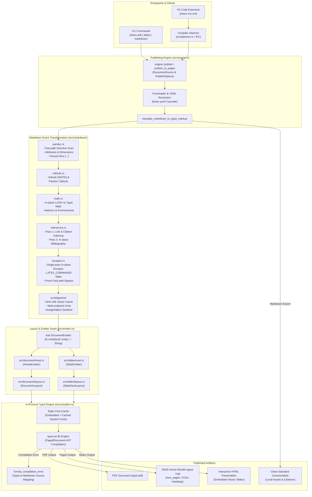
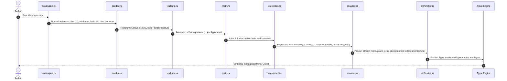
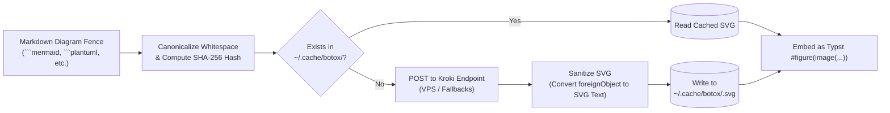

# Botox System Architecture Documentation

This document provides a comprehensive technical breakdown of the architecture, subsystems, and execution pipelines of **Botox** (the pure-Rust publishing engine) and **Botox-VSC-Ext** (its companion VS Code extension).

---

## 1. High-Level Architecture Overview

Botox replaces legacy LaTeX/Pandoc/Node toolchains by embedding an in-process Typst compilation engine (`typst-as-lib`) directly inside a single native binary, complemented by an SVG vector preview bridge for VS Code.

---

## 2. Core Subsystems

### 2.1 Publishing Engine (`src/engine.rs`)

The `PublishingEngine` acts as the deep coordinator for all document and presentation compilation workflows:
- **`DocumentSource`**: Abstracts inputs (`File(path)`, `Stdin(string)`, `Memory(string)`), decoupling file system access from pipeline execution.
- **`PublishOptions`**: Unified configuration bundle (output destination, target format, watch mode, custom fonts/themes, bibliography filters).
- **`PublishResult`**: Type-safe output summary (`Pdf`, `PdfBytes`, `Markdown`, `Pages`), providing execution timing and output paths.
- **Entrypoints**: `engine::publish`, `engine::publish_to_pages`, and `engine::publish_to_pdf_bytes`. Eliminates duplicate YAML frontmatter parsing and CLI orchestration between the CLI and persistent daemon.

---

### 2.2 Layout & Emitter Seam (`src/emitter.rs`)

Botox decouples transpiled markup from final layout generation through a clean emitter seam:
- **`trait DocumentEmitter`**: Core interface `fn emit(&self, body_typst: &str) -> String`.
- **`ArticleEmitter` (`src/document/mod.rs`)**: Layout adapter for academic papers and technical specifications. Coordinates margins, columns, abstract styling, and table of contents.
- **`SlideEmitter` (`src/slides/mod.rs`)**: Layout adapter for 16:9 interactive presentation decks. Coordinates slide counters, header styles, and quote blocks.
- **`DocumentLayout` (`src/document/layout.rs`)**: Theme-driven title/abstract header layout, multi-column flow, and gutter configuration.
- **`SlideDeckLayout` (`src/slides/layout.rs`)**: Slide deck segmentation outside code fences, hero title placement, and progressive pause reveals (`#botox_pause`).
- **Shared Preamble Utilities**: Unified cross-platform font fallbacks (`format_font_stack`) and dynamic date rendering (`render_date_value`).

---

### 2.3 Modular Markdown Pipeline (`src/markdown/`)

Instead of invoking an external Pandoc binary, Botox translates extended Markdown into Typst syntax in memory:

* **`pandoc.rs`**: Fast-path scans lines for directives; normalizes attributes like `{#fig:arch width=80% height=300pt}`, converting dimensions (`px` $\rightarrow$ `pt`, `\linewidth` $\rightarrow$ `%`), cross-references (`@fig:`, `@tbl:`, `@sec:`), and fenced divs (`::: {.warning}`).
* **`callouts.rs`**: Converts GitHub-style callouts (`> [!NOTE] Title`) and Pandoc divs into `#botox_callout("type", "title")[...]`. Safely handles empty titles.
* **`math.rs`**: Transpiles LaTeX syntax to Typst math. Operates in-place with token boundary matching and descending length sorting to prevent command collisions (e.g., `\tanh` vs `\tan`, `\leftarrow` vs `\le`).
* **`references.rs`**: Two-pass citation engine. Pass 1 indexes external URLs and footnotes; Pass 2 directly emits IEEE-numbered citations `[1]` and references blocks without intermediate placeholder string searching.
* **`escapes.rs`**: Vectorized prose fast-path bypassing string copies on plain text; single-pass character traversal matching `LATEX_COMMANDS` table (`\newpage`, `\today`, etc.) and `#sub[...]` / `#super[...]` brackets without synthetic sentinel tokens.
* **`tables.rs`**: Extracts `Table: Caption {#tbl:id}` blocks and pairs them with markdown tables into Typst `#figure(...)` blocks.

---

### 2.4 Vector Diagram Pipeline (`src/diagrams/`)

Botox features built-in vector rendering for **Mermaid**, **PlantUML**, **UMLet**, **Graphviz**, and **D2**:

1. **Hashing & Caching:** Diagram source code is stripped of trailing spaces and invariant line endings, hashed via SHA-256, and checked against `~/.cache/botox/<hash>.svg`. Cache hits take **< 1ms**.
2. **Kroki Multi-Endpoint Fallback:** On cache misses, requests are sent to the configured Kroki service (with failover support).
3. **SVG Sanitization:** Mermaid diagrams often render text labels inside HTML `<foreignObject>` divs, which PDF layout engines cannot render. Botox converts these into standard SVG `<text>` and `<tspan>` nodes with proper coordinate transforms.

---

### 2.5 Compilation & Vector Layout (`src/compiler.rs`)

1. **In-Process Typst Compilation:** Uses `typst-as-lib` directly inside the Rust binary, bypassing disk serialization and external process overhead.
2. **Multi-Tier Font Cache (`LOADED_CUSTOM_FONTS`):**
   - Embedded fonts (`New Computer Modern`, `DejaVu Sans Mono`, math symbols) are statically baked into the binary.
   - System fonts discovered via `fontdb::Database` are cached in memory (`RwLock<HashMap<String, Vec>>`), avoiding redundant disk reads and font table parsing on successive compilations.
3. **Source-Mapped Diagnostic Reporting:** When Typst errors occur, Botox maps bytecode spans back to Markdown source lines, reporting accurate line and column numbers.

---

### 2.6 VS Code Extension Bridge (`botox-vsc-ext`)

1. **Binary Resolution:** Resolves the compiler via:
   - User-configured setting `botox.executablePath`
   - `~/.local/bin/botox`
   - `~/.cargo/bin/botox` (ensuring Cargo installs are detected in desktop GUI environments)
   - System `$PATH`
2. **JSON Vector IPC / Persistent Daemon:** The extension calls `botox compile <input.md> -o <temp.json> --json-pages` or communicates via the background daemon (`botox daemon`). The binary outputs page count, per-page SVG vector markup, and heading metadata.
3. **Secure Webview:** Renders vector pages in a dedicated panel with strict Content Security Policy (`default-src 'none'`), synchronizing scroll positions via heading interpolation and tracking live document edits.
